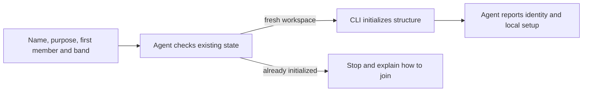

## Tell the agent about the project

```text
Initialize this as the “Acme Billing” workspace. Its purpose is subscription
billing for small businesses. Add me as Maya. Write my intents and plans in
Indonesian with a semi-formal tone, while keeping technical terms in English.
```

The agent uses the pinned CLI, through the launcher, to create the shared workspace structure, adds Maya to the roster with an allocation band, and selects her on this machine. It then runs `agent setup`, which refreshes native agent-role definitions for the hosts this workspace supports and turns Claude Code's commit and pull request attribution off in the gitignored `.claude/settings.local.json`.

Every workspace has a roster, and every member holds a band, including a person working alone: they are a team of one. A band divides the ID range, so band 1 writes `i100` and `p1000`. The agent suggests band 1 for the first member; band 0 is a band like any other and starts at `i001` and `p0001`. You can also record free-text roles, such as maintainer or docs, which say what a member contributes and authorize nothing. A new workspace starts at schema 3, with one ID file per member under `.context-circuit/ids/`.

## The setup gate

Setup is complete when the roster lists at least one member, every member holds a band, and this machine has selected one of them. Until then the agent declines any request that would change something and says why; reading, questions, and status still work. The CLI reports the same gaps from `status`: `identity_required` when no listed member is selected here, and `band_required`, with a suggested band, when a member holds none. The agent asks who you are — a listed member or someone new to add — or offers the suggested band for you to confirm, then carries out your original request without asking you to repeat it.

The CLI allocates and writes the structured fields. The agent writes the meaningful project description and language preferences. Initialization preserves existing files and refuses to silently reinitialize an active workspace.



## Join an existing workspace

A clone already carries the shared project identity. Do not initialize it again. Say:

```text
This is an existing team workspace. Set up this machine for the existing member
`maya`, connect the workspace checkout starting from `main`, and refresh the
native agent roles without overwriting custom definitions.
```

The agent asks you to choose if the member ID is ambiguous, then uses the CLI to create only machine-local bindings. Changing requests wait until this machine has selected someone in the roster; reading and questions still work. Host role definitions and the attribution setting are ignored by Git, so a fresh clone runs `agent setup`, and the coding host may need to reload them.

Then [connect the implementation repositories](/docs/get-started/connect-repositories).
